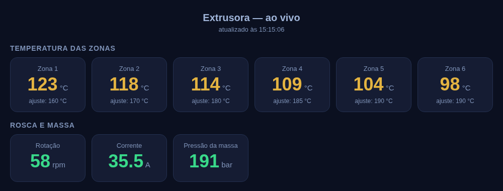

# modbus-painel


Leitura **Modbus TCP** em Python puro e um **painel web ao vivo** configurado por um arquivo TOML.
Nasceu do chão de fábrica: ler temperaturas, rotação e pressão de extrusoras num CLP (WEG PLC300, controladores atrás de gateway) e mostrar numa tela que qualquer operador entende.



## Por que existe

Bibliotecas Modbus completas são ótimas, mas, para *olhar* uma máquina, quase sempre bastam poucas coisas, e são justamente elas que dão trabalho na prática:

- **CLP que derruba a conexão ociosa.** O cliente mantém o socket aberto e reconecta sozinho, sem perder a leitura.
- **Leitura com ruído.** Um valor fora da faixa plausível (um 65000 °C, por exemplo) é descartado: o painel mantém o último valor bom e marca como antigo, em vez de piscar lixo na tela.
- **Equipamento lento ou atrás de gateway.** Uma única thread lê em sequência e junta registradores vizinhos numa leitura só. O comando `units` descobre quais unit ids respondem.
- **Segurança.** É **somente leitura**: o cliente não implementa nenhuma função de escrita, então não há como alterar um ajuste da máquina por engano.

## Uso rápido

Sem CLP? Suba a extrusora simulada e abra o painel de exemplo:

```bash
python -m modbus_painel simular                              # terminal 1
python -m modbus_painel painel exemplos/extrusora.toml       # terminal 2 → http://127.0.0.1:8899
```

Com um aparelho de verdade:

```bash
python -m modbus_painel ler 192.168.0.10 -u 2 -a 0 -n 20     # 20 holding registers do unit 2
python -m modbus_painel ler 192.168.0.10 -a 100 -r 2         # repete a cada 2 s
python -m modbus_painel units 192.168.0.10                   # quais unit ids respondem?
```

Também dá para instalar com `pip install .` e usar o comando `modbus-painel`.

## Configurando o painel

```toml
titulo = "Extrusora 2"

[aparelho]
host = "192.168.0.10"
porta = 502
unit = 1
intervalo = 3            # segundos entre leituras

[[grupo]]
nome = "Temperatura das zonas"
valor = [
  # registrador do valor, registrador do ajuste, faixa plausível e tolerância para alerta
  { nome = "Zona 1", registrador = 100, ajuste = 110, unidade = "°C", minimo = 0, maximo = 400, tolerancia = 8 },
]

[[grupo]]
nome = "Rosca"
valor = [
  { nome = "Corrente", registrador = 121, unidade = "A", escala = 10 },   # bruto 385 → 38.5 A
  { nome = "Delta", registrador = 130, sinal = true },                    # inteiro de 16 bits com sinal
  { nome = "Ligada", registrador = 0, funcao = 1 },                       # coil
  { nome = "Zona do módulo 3", registrador = 0, unit = 3 },               # outro unit id
]
```

| Campo | Para quê |
|---|---|
| `escala` | divide o valor bruto (décimos, centésimos) |
| `funcao` | 1 coils, 2 entradas digitais, 3 holding (padrão), 4 input |
| `unit` | lê de outro unit id que não o do `[aparelho]` |
| `sinal` | trata o registrador como inteiro com sinal |
| `minimo` / `maximo` | faixa plausível. Fora dela, mantém o último valor bom |
| `ajuste` + `tolerancia` | registrador do setpoint. Fica amarelo quando o valor se afasta mais que a tolerância |

O painel expõe os dados em JSON em `/dados`, para integrar com outro sistema.

## Usando como biblioteca

```python
from modbus_painel.cliente import ClienteModbus, para_32_bits

with ClienteModbus("192.168.0.10", unit=2) as clp:
    temperaturas = clp.ler(0, 3)               # holding registers 0..2
    alto, baixo = clp.ler(200, 2)
    contador = para_32_bits(alto, baixo)
```

## Testes

```bash
python -m unittest discover -s tests -v
```

Os testes sobem o simulador numa porta livre e exercitam o cliente de verdade: reconexão depois de o aparelho derrubar o socket, resposta chegando byte a byte, exceção de gateway, faixa plausível e agrupamento de leituras. Rodam no GitHub Actions com Python 3.11 a 3.13.

## Licença

MIT
